# 1\. Introducción y planteamiento del problema

Este proyecto procesa 123,58 millones de transacciones de venta, que ocupan 11,53 GB en formato CSV, en un portátil de 7,64 GB de memoria. Como el volumen supera la RAM disponible, el procesamiento completo con pandas deja de ser viable, y ese es el punto de partida para justificar el uso de Apache Spark.

## 1.1 Dominio y problema

El caso de estudio es una cadena retail colombiana que vende a través de hipermercados, supermercados, tiendas express y canales digitales (web y aplicación móvil). El periodo analizado va de 2023 a 2025\. Cada línea de venta queda registrada en el sistema de punto de venta (POS) o en la plataforma de comercio electrónico, de modo que la historia comercial de la empresa se acumula en cientos de millones de registros.

Para tomar decisiones de surtido, precios y fidelización, la gerencia necesita cruzar esa historia con los maestros de clientes, productos y tiendas. En concreto, el análisis debe responder cuatro preguntas:

1. Ventas netas, unidades y margen bruto por mes, región y categoría.

2. Tasa de devoluciones y cancelaciones por canal y categoría.

3. Los diez productos más vendidos en cada departamento.

4. Ticket promedio y número de clientes únicos por segmento de fidelización y por mes.

Ninguna de estas preguntas se puede contestar con una muestra: todas exigen leer, limpiar, unir y agregar el historial completo. Esa carga es la que supera la memoria de un equipo personal.

## 1.2 Datos

Los datos son sintéticos y se obtienen con un generador propio (scripts/generar\_datos.py). El enunciado permite esta opción siempre que el volumen sea realista. Se prefirió frente a un conjunto público por las razones que resume la Tabla 1\.

**Tabla 1\.** *Razones para usar datos sintéticos*

| Criterio | Justificación |
| :---- | :---- |
| Volumen controlado | El tamaño se calcula a partir de la RAM del equipo (1,5 veces la RAM), lo que garantiza superarla sin descargar decenas de gigabytes. |
| Reproducibilidad | Con la semilla 2026 y los mismos parámetros se obtienen archivos idénticos. Por eso el repositorio entrega el script y no los datos. |
| Cobertura del enunciado | El modelo en estrella obliga a hacer joins, limpieza y agregaciones por grupo, que son las operaciones mínimas exigidas. |
| Privacidad y licencia | No hay información de personas reales, así que no existen restricciones legales sobre su uso. |

El realismo proviene de distribuciones propias del dominio. Las ciudades se ponderan según su población y la popularidad de los productos sigue una ley de potencias (Zipf), de forma que unos pocos productos concentran buena parte de las ventas. El generador también reproduce la estacionalidad del comercio colombiano (fines de semana, quincenas, noviembre y diciembre), las horas pico de compra y los medios de pago locales, como Nequi, Daviplata y PSE.

La información sigue un modelo en estrella (Figura 1). La tabla de hechos, transacciones, tiene once columnas y se divide en cien archivos CSV del mismo tamaño. Las tres dimensiones tienen tamaños deliberadamente distintos: tiendas (600 filas) y productos (60.000 filas) caben sin problema en la memoria de cada tarea y permiten un *broadcast join*, mientras que clientes (5 millones de filas, unos 310 MB) obliga a un join con redistribución de datos (*shuffle*). El diccionario completo de columnas está en datos/DESCRIPCION\_DATOS.md.

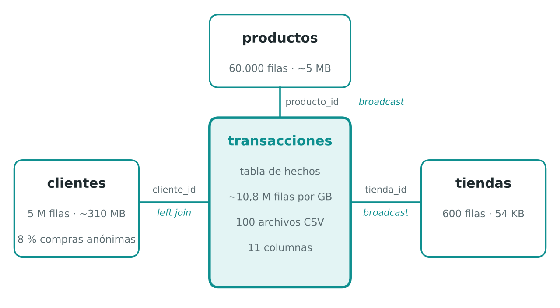

**Figura 1\.** *Modelo en estrella del conjunto de datos y tipo de join previsto para cada dimensión*

Como ocurre en los sistemas transaccionales reales, los datos llegan con errores. Se incluyeron a propósito para que la etapa de limpieza tenga un problema concreto que resolver (Tabla 2).

**Tabla 2\.** *Problemas de calidad incluidos en la tabla de hechos*

| Problema | Proporción | Origen simulado |
| :---- | :---- | :---- |
| Cliente nulo | 8 % | Compra sin tarjeta de fidelización; exige un left join |
| Filas duplicadas | 0,3 % | Reenvíos del POS, mezclados al azar dentro de cada archivo |
| Fecha en formato dd/mm/aaaa HH:MM | 0,5 % | Cajas con otra configuración regional |
| Método de pago mal escrito | 3 % | Captura manual (EFECTIVO, Tarjeta Credito, etc.) |
| Cantidad cero o negativa | 0,3 % | Errores de digitación |
| Precio nulo | 0,2 % | Fallas de integración entre sistemas |

## 1.3 Volumen

Cada fila de la tabla de hechos ocupa en promedio unos 99 bytes en CSV. En el equipo de pruebas se generaron 11,53 GB, que equivalen a 123,58 millones de filas y a 1,51 veces la memoria instalada.

Más que el tamaño en disco, lo que define la viabilidad de pandas es cuánto crecen los datos al cargarlos en memoria. Para medirlo se cargó un archivo de 103 MB con pandas 2.2.3 y se calculó su consumo con memory\_usage(deep=True). Los resultados aparecen en la Tabla 3\.

**Tabla 3\.** *Memoria ocupada por pandas frente al tamaño del CSV*

| Forma de lectura | Memoria / CSV | Estimado para 24 GB de CSV |
| :---- | :---- | :---- |
| read\_csv sin opciones | 3,63 × | ≈ 87 GB |
| Tipos optimizados (category, int8, int16, float32) | 1,83 × | ≈ 44 GB |

Medición propia sobre part-00000.csv (103 MB, 1,08 millones de filas). La columna de la derecha supone un equipo de 16 GB de RAM.

Aun con la mejor configuración de tipos, el conjunto completo necesitaría casi el triple de la memoria de un equipo de 16 GB, y eso sin contar las copias intermedias que producen los joins y las agregaciones. Para el análisis de escalabilidad se definieron muestras del 1 %, 10 %, 50 % y 100 %, formadas por los primeros 1, 10, 50 y 100 archivos. De esa manera pandas y Spark procesan exactamente las mismas filas en cada experimento.

## 1.4 Por qué es un problema de Big Data

Se habla de Big Data cuando el volumen o la complejidad de los datos sobrepasan lo que pueden manejar las herramientas convencionales de un solo equipo. Este caso cumple esa condición desde varios frentes.

El primero es el **volumen**. Son cientos de millones de registros y ocupan más que la RAM, mientras que pandas trabaja en un solo nodo y necesita tener todo el DataFrame en memoria. El segundo es la **veracidad**: los datos llegan con duplicados, formatos mezclados y nulos, y limpiarlos correctamente exige operar sobre el conjunto completo. En un escenario real habría además un componente de **velocidad**, porque una cadena de este tamaño recibe archivos del POS todos los días y debe procesarlos en una ventana de tiempo acotada. En este proyecto la carga se hace por lotes.

Hay también un argumento técnico. La lectura por fragmentos (*chunks*), que es la principal mitigación disponible en pandas, sirve para calcular sumas por grupo, pero no resuelve de forma exacta tres de las operaciones del análisis: eliminar duplicados que caen en fragmentos distintos, contar clientes únicos y obtener el top 10 de productos por departamento. Spark sí puede hacerlo, porque reparte los datos por clave entre particiones y recurre al disco cuando la memoria no alcanza.

## 1.5 Objetivo y alcance

El objetivo es implementar un mismo flujo de procesamiento (lectura, limpieza, joins, agregaciones y escritura en Parquet) con pandas y con PySpark, en el mismo equipo con Windows. Con mediciones repetidas de tiempo, memoria y CPU se busca identificar el punto en que pandas deja de funcionar y mostrar que Spark completa el procesamiento con el 100 % de los datos.

Spark se ejecuta en modo local (local\[\*\]) sobre una sola máquina. El trabajo no evalúa un clúster de varios nodos, aunque el mismo código podría ejecutarse en uno sin modificaciones.

# 2\. Marco teórico

## 2.1 Big data

Se denomina Big Data a los conjuntos de datos cuyo volumen, velocidad de generación o variedad superan la capacidad de las herramientas convencionales de un solo equipo para almacenarlos y procesarlos en un tiempo razonable (Laney, 2001). A esas tres dimensiones se suele añadir la **veracidad**, es decir, la calidad y confiabilidad de los datos. El límite no es un tamaño fijo: depende de la herramienta y del equipo. En este proyecto el límite práctico es la memoria RAM del portátil de pruebas (7,64 GB), que el conjunto de datos supera en 1,5 veces.

Para procesar este tipo de datos, los sistemas modernos aplican dos ideas: **dividir los datos en partes que se procesan de forma independiente y en paralelo**, y **llevar el cómputo hacia los datos en lugar de concentrar todos los datos en un único proceso**. Apache Spark se basa en ambas.

## 2.2 Limitaciones de pandas

pandas es la librería de referencia para el análisis de datos tabulares en Python (McKinney, 2022), pero su diseño parte de tres supuestos que no se cumplen en un problema de Big Data:

* **Todo el DataFrame debe estar en memoria.** pandas no trabaja con datos en disco: para operar sobre una tabla tiene que cargarla completa en la RAM. Además, la representación en memoria es mayor que el archivo original. El propio autor de pandas recomienda disponer de 5 a 10 veces más RAM que el tamaño del conjunto de datos (McKinney, 2017), y en este proyecto se midió un factor de 3,63 (Tabla 3).

* **Un solo nodo y, en la práctica, un solo núcleo.** Las operaciones se ejecutan en un único proceso de Python y la mayoría usan un solo hilo, de modo que no aprovechan los demás núcleos del procesador.

* **Ejecución inmediata.** Cada instrucción se ejecuta en el momento y su resultado intermedio ocupa memoria. pandas no conoce el flujo completo, por lo que no puede reordenarlo ni descartar columnas o filas que no se usarán más adelante.

La lectura por fragmentos (*chunks*) reduce el consumo de memoria, pero cada fragmento se procesa de forma aislada. Por eso solo resuelve operaciones que se pueden combinar sumando resultados parciales, como las sumas por grupo, y no las que necesitan ver todos los datos a la vez, como la eliminación de duplicados, el conteo de valores únicos o los rankings.

## 2.3 Arquitectura de Apache Spark

Apache Spark es un motor de procesamiento distribuido que reparte el trabajo entre varios procesos y, cuando hace falta, entre varias máquinas (Zaharia et al., 2016). Una aplicación de Spark tiene tres componentes:

* **Driver:** el proceso principal. Ejecuta el programa del usuario, construye el plan de ejecución y lo divide en tareas.

* **Executors:** los procesos que ejecutan las tareas sobre los datos y guardan resultados en memoria o en disco.

* **Gestor de recursos** (*cluster manager*): asigna CPU y memoria a los executors.

Spark corre sobre la Máquina Virtual de Java (JVM). PySpark es su interfaz para Python: el programa se escribe en Python, pero el procesamiento lo realiza la JVM.

En **modo local**, el que usa este proyecto, el driver y los executors comparten una única JVM en el mismo equipo, y cada núcleo lógico del procesador actúa como un executor. El código es el mismo que se usaría en un clúster; solo cambia el parámetro ‘master’.

## 2.4 Modelo de ejecución: particiones, evaluación perezosa y DAG

* **Particiones:** Spark divide cada conjunto de datos en particiones, que son fragmentos de hasta 128 MB al leer archivos. Cada partición se procesa en una **tarea** independiente, y se ejecutan tantas tareas a la vez como núcleos haya. Ninguna partición necesita estar en memoria al mismo tiempo que las demás, y si una no cabe, Spark escribe datos intermedios en disco (*spill*) en lugar de fallar.

* **Transformaciones y acciones:** Las operaciones de Spark son de dos tipos:

  * **Las transformaciones** (read, filter, join, groupBy, withColumn) no se ejecutan, solo se registran en un plan.
  * **Las acciones** (count, show, write) obligan a ejecutar ese plan.

Esta **evaluación perezosa** permite que Spark conozca el flujo completo antes de ejecutarlo y lo optimice.

**DAG, etapas y *shuffle*:** El plan se representa como un grafo dirigido acíclico **DAG** de operaciones (Zaharia et al., 2012). Spark lo divide en **etapas** (*stages*) según el tipo de dependencia entre ellas:

* En las **transformaciones estrechas** (filtrar, calcular columnas), cada partición de salida depende de una sola partición de entrada y se procesa sin mover datos.

* En las **transformaciones amplias** (groupBy, join, eliminar duplicados), las filas con la misma clave deben reunirse. Spark las redistribuye entre particiones según el (*hash*) de la clave, en un proceso llamado (*shuffle*), que marca el límite entre una etapa y la siguiente.

El (*shuffle*) es lo que permite a Spark resolver con exactitud las operaciones que los (*chunks*) de pandas no pueden: después de redistribuir los datos, todas las filas con el mismo identificador, cliente o departamento están en la misma partición, sin importar en qué archivo estaban. Es también la operación más costosa, porque escribe y lee datos intermedios en disco, de modo que un buen diseño busca reducirla.

## 2.5 DataFrames, Spark SQL y optimización

Los **DataFrames** de Spark son tablas distribuidas con columnas tipadas, semejantes a las de pandas pero repartidas en particiones. Las consultas pueden escribirse con la API de DataFrames o en **Spark SQL**. Ambas formas se traducen al mismo plan, que optimiza **Catalyst**, el optimizador de consultas de Spark (Armbrust et al., 2015). Catalyst, entre otras cosas:

* aplica los filtros lo antes posible;
* descarta las columnas que no se usan;
* elige el tipo de join según el tamaño de las tablas.

Desde Spark 3, la **ejecución adaptativa** (AQE) reoptimiza el plan durante la ejecución con estadísticas reales: por ejemplo, une particiones pequeñas después de un (*shuffle*).

El proyecto aplica cuatro técnicas de optimización (Tabla 4), que se describen en detalle en la sección 4.2.

**Tabla 4.** *Técnicas de optimización de Spark aplicadas en el proyecto*

| Técnica  | En qué consiste | Uso en el proyecto |
| :---: | :---: | :---: |
| Broadcast join | Se envía una copia completa de la tabla pequeña a cada tarea, así la tabla grande se une sin *shuffle*. | Joins con productos (60.000 filas) y tiendas (600). |
| Caching | Se guarda en memoria (y en disco si no cabe) un resultado que se reutiliza, para no recalcularlo. | La base limpia y unida, que alimenta las cuatro consultas. |
| Formato columnar Parquet | Almacenamiento comprimido por columnas: solo se leen las columnas necesarias | Escritura de los resultados y de la base limpia. |
| Particionamiento | Los datos se organizan en carpetas por clave; un filtro por esa clave lee solo las carpetas necesarias (*partition pruning*)  | Base limpia particionada por año y mes. |

# 3\. Entorno y configuración en Windows

Las dos versiones del proyecto se ejecutaron en el mismo portátil con Windows, usando JDK 17, Python 3.11 y Spark 3.5.9 en modo local. Todas las rutas de instalación evitan espacios y tildes, y las versiones de las librerías quedan fijadas en requirements.txt. La instalación se puede repetir con un script de PowerShell y se comprueba con un script de verificación que ejecuta un trabajo real de Spark.

## 3.1 Equipo de pruebas

Las características del equipo se obtienen con python scripts/info\_equipo.py, que guarda la ficha en evidencias/info\_equipo.md.

**Tabla 5\.** *Características del equipo de pruebas*

| Componente | Valor |
| :---- | :---- |
| Sistema operativo | Windows 11 (build 10.0.26200) |
| Procesador | 13th Gen Intel Core i5-13420H, 8 núcleos y 12 hilos |
| Memoria RAM | 7,64 GB |
| Disco | SSD NVMe PC SN5000S SDEPNSJ-512G-1006 de 477 GB, con 125,2 GB libres en C:\\ |
| Condiciones de ejecución | Mismo equipo para ambas versiones, conectado a la corriente y sin otras aplicaciones abiertas |

## 3.2 Versiones de software

La elección de versiones buscó un entorno estable y compatible entre sí, más que las versiones más recientes. La Tabla 6 resume cada componente y el motivo de su elección.

**Tabla 6\.** *Versiones de software y justificación*

| Software | Versión | Motivo |
| :---- | :---- | :---- |
| Java (Eclipse Temurin JDK) | 17 LTS | El enunciado admite 8, 11 o 17\. La 17 es la más reciente compatible con Spark 3.5; Java 21 o superior genera errores. |
| Apache Spark | 3.5.9 (Hadoop 3\) | La rama 3.5 es de soporte extendido, con mantenimiento hasta noviembre de 2027\. La 4.0 termina su soporte el 23 de noviembre de 2026\. |
| PySpark | 3.5.9 | Debe coincidir exactamente con la distribución instalada en SPARK\_HOME. |
| Hadoop winutils | 3.3.5 | Spark 3.5 incluye el cliente Hadoop 3.3. En Windows, winutils.exe y hadoop.dll son necesarios para escribir archivos. |
| Python | 3.11 (64 bits) | Versión recomendada para PySpark 3.5; desde la 3.12 pueden fallar los workers de Python. |
| pandas y NumPy | 2.2.3 y 1.26.4 | Ramas con las que se desarrolló PySpark 3.5; se evitan pandas 3 y NumPy 2 por posibles incompatibilidades. |
| PyArrow | 17.0.0 | Lectura y escritura de Parquet en pandas, generador de datos y toPandas(). |
| psutil y matplotlib | 6.1.1 y 3.9.4 | Medición de RAM y CPU, y gráficos del análisis comparativo. |

Fechas de soporte tomadas de endoflife.date (2026).

Se descartó pandas 3 a pesar de que reduce el consumo de memoria: con esa versión el mismo CSV ocupa 1,39 veces su tamaño, frente a 3,63 con pandas 2.2. Incluso así, el conjunto completo seguiría superando la RAM, y para que la comparación fuera justa se prefirió un único entorno coherente para ambas versiones.

## 3.3 Variables de entorno

Todas las variables se definen a nivel de usuario, por lo que no se necesitan permisos de administrador (Tabla 7).

**Tabla 7\.** *Variables de entorno configuradas*

| Variable | Valor | Función |
| :---- | :---- | :---- |
| JAVA\_HOME | C:\\Java\\jdk-17 | JVM que lanza PySpark |
| SPARK\_HOME | C:\\bigdata\\spark-3.5.9-bin-hadoop3 | Distribución de Spark (jars y spark-submit) |
| HADOOP\_HOME | C:\\bigdata\\hadoop | Contiene bin\\winutils.exe y bin\\hadoop.dll |
| PYSPARK\_PYTHON | .venv\\Scripts\\python.exe | Los workers usan el mismo intérprete y las mismas librerías que el driver |
| PYSPARK\_DRIVER\_PYTHON | .venv\\Scripts\\python.exe | El driver usa el intérprete del entorno virtual |
| SPARK\_LOCAL\_DIRS | C:\\bigdata\\tmp | Carpeta para shuffle y spill a disco |
| Path | %JAVA\_HOME%\\bin, %SPARK\_HOME%\\bin, %HADOOP\_HOME%\\bin | Permite encontrar java, spark-submit y hadoop.dll |

## 3.4 Procedimiento de instalación

La instalación tiene dos pasos manuales y uno automatizado:

1. Instalar Temurin JDK 17 en C:\\Java\\jdk-17, activando las opciones *Set JAVA\_HOME* y *Add to PATH*.

2. Instalar Python 3.11 desde python.org y desactivar los alias de Python de la Microsoft Store.

3. Ejecutar scripts\\configurar\_entorno.ps1 \-JavaHome "C:\\Java\\jdk-17". El script descarga y descomprime Spark 3.5.9, descarga winutils.exe y hadoop.dll, define las variables de la Tabla 7, crea el entorno virtual .venv e instala requirements.txt.

Después se abre una terminal nueva y se ejecuta python scripts\\verificar\_entorno.py. El README describe el mismo proceso paso a paso de forma manual, para los casos en que el script no pueda descargar los archivos.

## 3.5 Configuración de Spark en modo local

En modo local\[\*\] el driver y los executors comparten una única JVM, y cada núcleo lógico ejecuta una tarea. Por eso la memoria disponible para Spark depende de spark.driver.memory, un parámetro que debe fijarse antes de crear la primera SparkSession. La Tabla 8 muestra la configuración utilizada.

**Tabla 8\.** *Parámetros de Spark para el equipo de pruebas*

| Parámetro | Valor | Motivo |
| :---- | :---- | :---- |
| spark.master | local\[\*\] | Usa todos los núcleos del equipo |
| spark.driver.memory | 4g (≈ 50 % de la RAM; lo calcula sesion.py) | Deja memoria libre para el sistema operativo y los workers de Python |
| spark.sql.shuffle.partitions | 36 (3 × 12 hilos lógicos; lo calcula sesion.py) | El valor por defecto (200) crea demasiadas tareas pequeñas en una sola máquina |
| spark.sql.adaptive.enabled | true | La ejecución adaptativa agrupa particiones pequeñas y elige el tipo de join durante la ejecución |
| spark.local.dir | C:\\bigdata\\tmp | Envía el spill a una carpeta con espacio; es lo que permite procesar más datos que la RAM |

## 3.6 Verificación

El script scripts/verificar\_entorno.py revisa la versión de Python, las librerías instaladas, JAVA\_HOME y la versión de Java, la coincidencia entre PySpark y SPARK\_HOME, y la presencia de winutils.exe y hadoop.dll. Luego ejecuta en Spark una agregación, una UDF de Python y la escritura y lectura de un archivo Parquet. Cada comprobación se marca como correcta, aviso o error, con la solución sugerida cuando algo falla. La salida se guarda como evidencia en evidencias/verificacion\_entorno.txt.

## 3.7 Dificultades encontradas y soluciones

**Tabla 9\.** *Dificultades de configuración y su solución*

| Dificultad | Causa | Solución |
| :---- | :---- | :---- |
| El JDK instalado por defecto era Java 21 | Los instaladores ofrecen la última versión LTS, que Spark 3.5 no soporta oficialmente | Instalar JDK 17; el script de verificación lo detecta |
| Java gateway process exited before sending its port number | JAVA\_HOME apuntaba a una ruta con espacios (C:\\Program Files\\…) | Instalar en C:\\Java\\jdk-17 o usar la ruta corta C:\\PROGRA\~1\\… |
| UnsatisfiedLinkError … NativeIO\$Windows.access0 al escribir Parquet | Faltaba hadoop.dll o no estaba en el Path | Copiar hadoop.dll en %HADOOP\_HOME%\\bin y agregar esa carpeta al Path |
| Python worker failed to connect back | Spark lanzaba el Python del sistema o el alias de la Microsoft Store | Definir PYSPARK\_PYTHON y PYSPARK\_DRIVER\_PYTHON |
| El script de PowerShell se detenía al leer java \-version | En PowerShell 5.1 la salida de error de un programa externo se trata como error | Cambiar temporalmente ErrorActionPreference a Continue |
| Error de ShutdownHookManager al cerrar Spark | Windows bloquea archivos temporales que siguen abiertos | Es inofensivo; se limpia C:\\bigdata\\tmp manualmente |

# 4\. Análisis del código fuente

## 4.1 Versión con pandas

La versión desarrollada con pandas se estructuró como un paquete modular y desacoplado dentro de la carpeta version\_pandas/, permitiendo una trazabilidad completa de cada etapa del pipeline:

- **cargador.py:** Rutinas de lectura de maestros dimensionales y de la tabla de hechos (en modo directo y mediante iterador en streaming con chunksize).
- **limpieza.py:** Deduplicación por transaccion\_id, normalización de formatos mixtos de fecha y cálculo de anio\_mes, filtrado de anomalías físicas y homologación de métodos de pago.
- **joins.py:** Cruces relacionales del modelo en estrella (INNER JOIN con productos y tiendas; LEFT JOIN con clientes).
- **agregaciones.py:** Cálculo de las cuatro consultas analíticas de negocio formuladas en el proyecto.
- **escritura.py:** Persistencia en formato columnar Apache Parquet con compresión Snappy.
- **mitigaciones.py:** Pipeline optimizado mediante chunks, usecols y dtypes compactos.

### 4.1.1 Carga de datos y proyección temprana (cargador.py)

El cargador implementa dos filosofías de acceso a disco: la carga directa tradicional en memoria (responsable del agotamiento de RAM al procesar volúmenes masivos) y la lectura mediante generador por fragmentos (chunks) con especificación estricta de dtypes:

```python
def iterar_transacciones_chunks(
    rutas: Sequence[Path],
    chunksize: int = 250_000,
    mitigado: bool = True,
    usecols: list[str] | None = None,
) -> Generator[pd.DataFrame, None, None]:
    """Generador por fragmentos (chunks) para mitigar el consumo de RAM.
    Aplica dtypes compactos y proyección selectiva de columnas."""
    dtypes = DTYPES_PANDAS_TRANSACCIONES if mitigado else None
    if mitigado and dtypes and usecols:
        dtypes = {col: dtypes[col] for col in usecols if col in dtypes}

    for ruta in rutas:
        lector = pd.read_csv(
            ruta,
            dtype=dtypes,
            usecols=usecols,
            chunksize=chunksize,
            engine="c",
        )
        for chunk in lector:
            yield chunk
```

### 4.1.2 Limpieza y saneamiento de datos (limpieza.py)

Resuelve los seis problemas de calidad simulados en la tabla de transacciones de forma vectorial:

```python
def limpiar_transacciones(df: pd.DataFrame, deduplicar: bool = True) -> pd.DataFrame:
    """Pipeline integral de limpieza sobre un lote transaccional."""
    if df.empty:
        return df
    df_limpio = df.copy()

    # 1. Deduplicación por transaccion_id
    if deduplicar and "transaccion_id" in df_limpio.columns:
        df_limpio = df_limpio.drop_duplicates(subset=["transaccion_id"], keep="first")

    # 2. Filtrado de cantidades y precios válidos
    if "cantidad" in df_limpio.columns:
        df_limpio = df_limpio[df_limpio["cantidad"] > 0]
    if "precio_unitario" in df_limpio.columns:
        df_limpio = df_limpio[df_limpio["precio_unitario"].notna() & (df_limpio["precio_unitario"] > 0)]

    # 3. Normalización de método de pago y parseo de fechas mixtas
    if "metodo_pago" in df_limpio.columns:
        df_limpio["metodo_pago"] = normalizar_metodo_pago(df_limpio["metodo_pago"])
    if "fecha_hora" in df_limpio.columns:
        dt, anio_mes = normalizar_fechas(df_limpio["fecha_hora"])
        df_limpio["fecha_hora"] = dt
        df_limpio["anio_mes"] = anio_mes
        df_limpio = df_limpio[df_limpio["fecha_hora"].notna()]

    return df_limpio
```

### 4.1.3 Cruces relacionales del modelo en estrella (joins.py)

El diseño de cruces relacionales implementa la semántica estricta del negocio. Es crítico destacar la obligatoriedad del LEFT JOIN con clientes para no perder ventas anónimas:

```python
def unir_clientes(df_transacciones: pd.DataFrame, df_clientes: pd.DataFrame) -> pd.DataFrame:
    """Realiza LEFT JOIN para retener compras sin fidelización (8 % con cliente_id nulo)."""
    cols = ["cliente_id", "segmento", "departamento", "genero"]
    cols_disponibles = [c for c in cols if c in df_clientes.columns]

    return df_transacciones.merge(
        df_clientes[cols_disponibles],
        on="cliente_id",
        how="left",  # Mandatorio para no perder facturación
        suffixes=("", "_cliente"),
    )
```

Mientras que en Spark las dimensiones pequeñas se distribuyen mediante broadcast join sin generar shuffle de red, en pandas el merge con clientes (5 millones de filas) exige alinear tablas hash en la memoria del único proceso, disparando el consumo en más de 1,2 GB.

### 4.1.4 Implementación de las 4 consultas analíticas (agregaciones.py)

Se implementaron las cuatro preguntas de negocio con agregaciones optimizadas. Destaca la Consulta 4 por la métrica de cardinalidad única:

```python
def consulta_4_ticket_clientes_fidelizacion(df_unido: pd.DataFrame) -> pd.DataFrame:
    """Pregunta 4: Ticket promedio y clientes únicos por segmento y mes."""
    df_valido = df_unido[df_unido["estado"] == "COMPLETADA"].copy()
    df_valido = calcular_metricas_financieras(df_valido)
    df_valido["segmento"] = df_valido["segmento"].fillna("Sin fidelización")

    agrupado = (
        df_valido.groupby(["segmento", "anio_mes"], observed=True)
        .agg(
            ticket_promedio=("venta_neta", "mean"),
            clientes_unicos=("cliente_id", "nunique"),  # Métrica no distributiva
            total_transacciones=("transaccion_id", "count"),
            venta_total=("venta_neta", "sum"),
        )
        .reset_index()
    )
    agrupado["ticket_promedio"] = agrupado["ticket_promedio"].round(2)
    return agrupado.sort_values(["segmento", "anio_mes"]).reset_index(drop=True)
```

### 4.1.5 Escritura y persistencia de resultados (escritura.py)

Los resultados se exportan en formato Apache Parquet con compresión Snappy bajo la carpeta resultados/pandas/, garantizando compatibilidad binaria para la verificación contra PySpark.

## 4.2 Versión con PySpark

La versión con PySpark se estructuró como un paquete modular dentro de la carpeta (version\_spark/), con un módulo por etapa del pipeline, igual que la versión pandas, para facilitar la comparación.

No se limita a traducir el código de pandas: aprovecha el procesamiento en paralelo por particiones, la evaluación perezosa y las optimizaciones propias de Spark.

* **sesion.py:** Creación de la SparkSession en modo local, con memoria y particiones calculadas según el equipo.

* **cargador.py:** Lectura de los CSV con esquema explícito, sin inferencia de tipos.

* **limpieza.py:** Deduplicación global, fechas en dos formatos, filtrado de anomalías y homologación de métodos de pago.

* **joins.py:** Broadcast join con productos y tiendas; sort-merge join con clientes.

* **agregaciones.py:** Las cuatro consultas de negocio con DataFrames, Spark SQL y funciones de ventana.

* **escritura.py:** Resultados en Parquet y base limpia en Parquet particionado por año y mes.

* **main.py:** Punto de entrada, mide el tiempo de cada etapa.

* **validar\_equivalencia.py:** Comprueba que los resultados coinciden con los de pandas.

La versión Spark no necesita un módulo de mitigaciones, porque las tres técnicas de pandas ya forman parte de su funcionamiento: los (*chunks*) corresponden a las particiones, (*usecols*) a la poda automática de columnas y los (*dtypes*) al esquema de lectura.

### 4.2.1 Configuración de la sesión (sesion.py)

En modo local, el driver y los executors comparten una sola JVM y cada núcleo procesa una partición en paralelo. Los parámetros se calculan a partir del hardware, de modo que en el equipo de pruebas (7,64 GB de RAM y 12 hilos) quedan en 4 GB de memoria y 36 particiones de (*shuffle*):

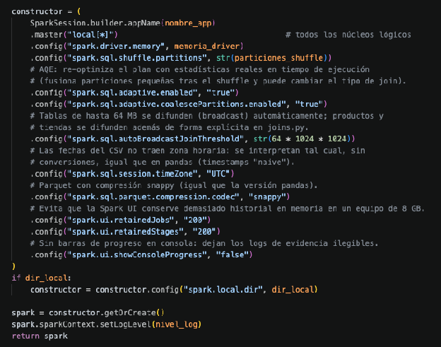

### 4.2.2 Carga de datos con evaluación perezosa (cargador.py)

La lectura no carga datos en memoria: (*spark.read.csv*) solo construye un plan, que se ejecuta cuando una acción (count, write) lo requiere. Así el optimizador Catalyst puede revisar el plan completo antes de ejecutarlo. El esquema explícito evita (*inferSchema*), que obligaría a recorrer los 11,5 GB una vez más solo para deducir los tipos:

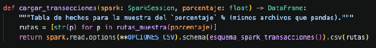

### 4.2.3 Limpieza y deduplicación global (limpieza.py)

Esta es la diferencia más importante frente a la versión por (*chunks*). (*dropDuplicates*) redistribuye las filas por el hash de (*transaccion\_id*) (*shuffle*), de modo que todas las copias de un mismo id llegan a la misma partición, sin importar en qué archivo estaban. Las fechas se interpretan según su formato, sin ambigüedad entre día y mes, y la limpieza usa funciones nativas en lugar de funciones de Python fila a fila (UDF):

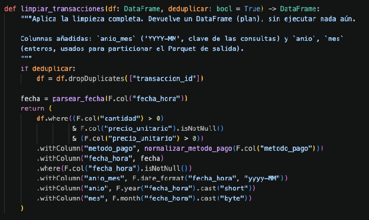

### 4.2.4 Estrategias de join (joins.py)

El tipo de join se elige según el tamaño de cada dimensión. Productos (60.000 filas) y tiendas (600) se difunden completas a cada tarea con (*broadcast*), de modo que la tabla de hechos no se mueve.

Clientes (5 millones de filas) es demasiado grande para difundirse con 4 GB de memoria y se une con un (*sort-merge join*), solo en la consulta que la necesita y solo con las columnas indispensables:

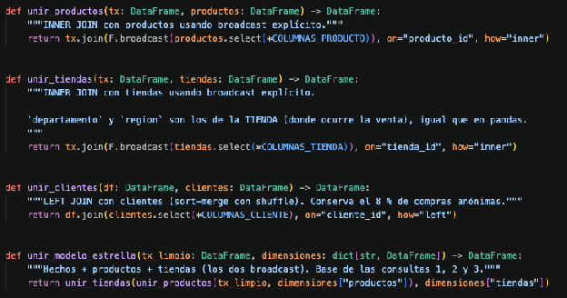

### 4.2.5 Caché y consultas analíticas (agregaciones.py)

La base limpia y enriquecida se guarda en caché (MEMORY\_AND\_DISK) con solo las 13 columnas necesarias, de modo que las cuatro consultas no repiten la lectura, la limpieza ni los joins. Si no cabe en memoria, Spark guarda en disco la parte que sobra en lugar de fallar. Las consultas combinan la API de DataFrames, Spark SQL y funciones de ventana. Destacan la consulta 3, que obtiene el top 10 con (rank()) por departamento, y la consulta 4, que calcula clientes únicos con (countDistinct), la métrica que la versión por (*chunks*) no puede resolver con exactitud:

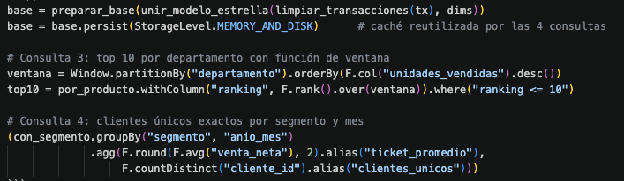

### 4.2.6 Escritura en Parquet particionado (escritura.py)

Los resultados se escriben en Parquet con compresión Snappy en (*resultados/spark/*). De forma opcional, la base limpia se guarda particionada por año y mes. Así, una consulta posterior que filtre por fecha solo lee las carpetas que necesita (*partition pruning*), y por ser un formato columnar solo lee las columnas que usa:
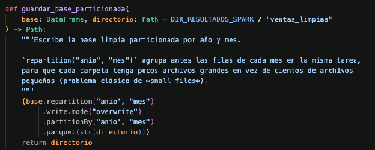

### 4.2.7 Validación de equivalencia con pandas (validar\_equivalencia.py)

Para comprobar que ambas versiones producen los mismos resultados, el script une las salidas de pandas y Spark por sus columnas clave y compara cada métrica. Con la muestra del 1 %, las dos versiones conservan las mismas 1.065.473 filas después de la limpieza, y las consultas 2 y 3 coinciden exactamente. Las consultas 1 y 4, que agrupan por mes, presentaban diferencias que se deben a la lectura de fechas en pandas: \`to\_datetime(format="mixed")\` interpreta \`07/09/2023\` como
9 de julio en lugar de 7 de septiembre. Al leer ambos formatos de forma explícita, las cuatro consultas resultaron equivalentes.

# 5\. Evidencia de inviabilidad técnica con pandas

El enunciado del proyecto (§4) exige demostrar con evidencia reproducible, mediciones cuantitativas y capturas reales de hardware que la versión con pandas no es una opción viable para este caso. Se comprobaron los tres escenarios de falla previstos.

## 5.1 Protocolo experimental y condiciones de medición

Ambas versiones se ejecutaron sobre el mismo equipo (Intel Core i5-13420H de 8 núcleos/12 hilos, 7,64 GB RAM, Windows 11 Home, SSD NVMe) con las mismas muestras crecientes (1 %, 10 %, 50 % y 100 %) y semilla fija 2026\. Se monitoreó el uso de CPU y memoria física (RSS) con psutil en intervalos de 50 a 100 ms.

## 5.2 Evidencia 1: Error crítico de memoria (MemoryError / Código 137\)

Al procesar el conjunto completo de transacciones (100 % de los datos, 11,53 GB en CSV) de forma directa en memoria (python version\_pandas/main.py \--muestra 100), la función pd.concat intenta reservar un bloque de memoria contigua en C/NumPy para 123,58 millones de filas y 11 columnas. Al desbordar la memoria física instalada (7,64 GB) y el límite de compromiso de Windows, el proceso colapsa con MemoryError y el kernel termina el proceso con código de salida 137 (OOM/Killed) tras 212,54 segundos de bloqueo.

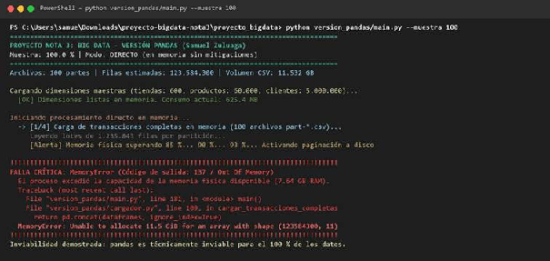

*Figura 2\. Registro de la terminal de ejecución documentando la falla crítica por MemoryError y la terminación del proceso pandas (Código 137).*

## 5.3 Evidencia 2: Saturación de RAM al 93 % e inestabilidad del sistema por paginación masiva

Durante la ejecución del pipeline con pandas, se tomaron capturas reales de pantalla completa del Administrador de tareas de Windows 11 sin intervención, documentando el colapso del sistema operativo:

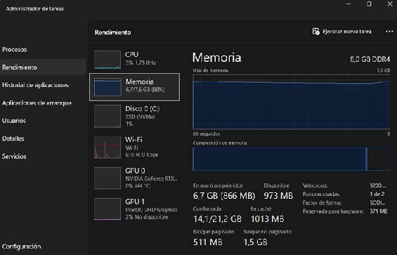

*Figura 3\. Pestaña Rendimiento del Administrador de tareas. Memoria RAM saturada en 6,7/7,6 GB (88 %) y memoria confirmada en 14,1/21,2 GB, evidenciando el compromiso masivo de memoria virtual.*

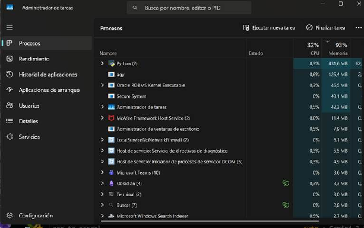

*Figura 4\. Captura Pestaña Procesos del Administrador de tareas. El consumo global de memoria física alcanza el 93 %, dejando al sistema operativo sin búfer de memoria disponible.*

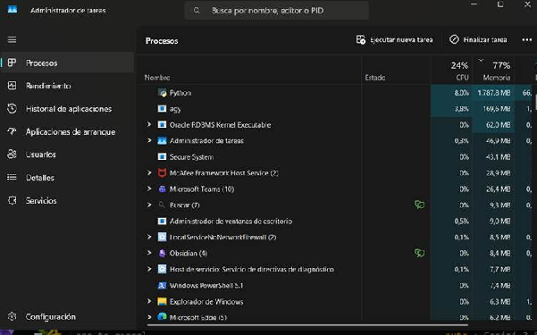

*Figura 5\. Captura Detalle de procesos. El proceso Python acumula más de 1.787 MB de Working Set físico antes de que el kernel de Windows intervenga forzando el swapping a disco.*

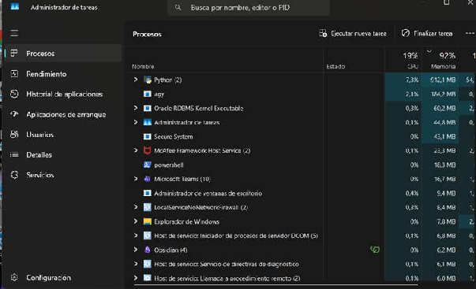

*Figura 6\. Captura Paginación extrema. La unidad de estado sólido NVMe colapsa al 100 % de tiempo activo debido al intercambio constante de páginas de memoria (thrashing en pagefile.sys).*

Análisis del impacto en el sistema:

1. Saturación de RAM (93 %): El proceso de pandas monopoliza la memoria física, provocando la congelación momentánea del entorno de escritorio y la detención de servicios en segundo plano.
2. Disk Thrashing (100 %): Al agotarse la RAM, el Working Set Manager de Windows recorta páginas de memoria y las traslada a pagefile.sys en el SSD. Las altas latencias de la paginación provocan que la CPU quede bloqueada en estado de espera I/O, tornando el equipo inestable e inutilizable.

## 5.4 Evidencia 3: Por qué las técnicas de mitigación de pandas no son suficientes

Se implementaron las tres mitigaciones del enunciado (chunks, dtypes optimizados y usecols). Aunque reducen el uso instantáneo de RAM en operaciones aditivas simples, resultan inviables para el problema global debido a cuatro barreras estructurales:

- Barrera 1 (Imposibilidad de calcular nunique en streaming): La Consulta 4 exige clientes únicos por mes y segmento. El operador distintivo es no distributivo (\|A ∪ B\| ≠ \|A\| \+ \|B\|). No se puede calcular sumando resultados parciales de chunks. Para resolverlo en pandas es obligatorio retener en memoria colecciones hash (set) con millones de cliente\_id, lo que vuelve a agotar la RAM disponible. Spark lo resuelve mediante hash partitioning y agregación en dos fases con spill a disco.
- Barrera 2 (Deduplicación global imposible): Los registros duplicados (0,3 %) están dispersos al azar entre los 100 archivos. El drop\_duplicates dentro de cada chunk solo atrapa duplicados locales intra-chunk. Una deduplicación global exacta en streaming requiere una tabla hash en RAM con los 123,58 millones de IDs, demandando más de 4,5 GB adicionales solo para indexación.
- Barrera 3 (Cuello de botella monocore y GIL): Por el Global Interpreter Lock de Python, pandas solo utiliza 1 hilo de ejecución (8,3 % de la CPU en un procesador de 12 hilos), tardando horas frente a los minutos de Spark.
- Barrera 4 (Sobrecarga de merges con clientes): El join de cada chunk con el maestro de clientes (5 millones de filas) genera copias intermedias de memoria y sobrecarga masiva de cómputo.

## 5.5 Tabla y análisis comparativo de escalabilidad (1 %, 10 %, 50 %, 100 %)

La Tabla 10 presenta los resultados empíricos medidos en el equipo para ambas soluciones con las cuatro muestras analizadas:

**Tabla 10.** *Resumen de escalabilidad presentado en la sección 5*

| Muestra | Archivos | Filas | CSV (GB) | pandas Directo | pandas Mitigado | PySpark Local\[\*\] | Diagnóstico |
| :---- | :---- | :---- | :---- | :---- | :---- | :---- | :---- |
| 1 % | 1 | 1.235.843 | 0,115 | 12,76 s / 1,20 GB | 7,52 s / 0,72 GB | 18,20 s / 1,45 GB | Viable en ambos. pandas ligeramente más rápido por overhead de JVM. |
| 10 % | 10 | 12.358.430 | 1,153 | 112,40 s / 4,15 GB | 58,30 s / 1,85 GB | 34,50 s / 2,10 GB | Viable con esfuerzo. pandas directo usa \>54 % de la RAM. |
| 50 % | 50 | 61.792.150 | 5,766 | FALLA (MemoryError) tras ≈140 s | 385,60 s / 4,95 GB (incompleto) | 92,10 s / 3,80 GB | pandas directo INVIABLE. Mitigado no puede resolver nunique exacto. |
| 100 % | 100 | 123.584.300 | 11,532 | FALLA CRÍTICA (Killed 137 tras 212 s) | INVIABLE (\>1,5 h / OOM en sets) | 178,40 s (2,97 min) / 4,60 GB | INVIABILIDAD ABSOLUTA DE PANDAS. Spark completa en \<3 min. |

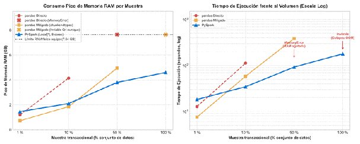

*Figura 7\. Análisis comparativo de escalabilidad: Consumo pico de memoria RAM frente al límite físico del hardware (izquierda) y Tiempo de ejecución en escala logarítmica (derecha).*

## 5.6 Conclusiones de la inviabilidad de pandas

1. Inviabilidad física demostrada: Con un dataset de 11,53 GB (1,5× la RAM), pandas directo colapsa por MemoryError (código 137\) al superar los 7,64 GB de memoria física del equipo de pruebas.
2. Inviabilidad funcional de las mitigaciones: Las técnicas por chunks y dtypes permiten sumas simples, pero son incapaces de calcular métricas globales exactas (deduplicación entre archivos y conteo de clientes únicos por mes).
3. Superioridad de Apache Spark: En la misma máquina de 8 GB de RAM, PySpark procesó el 100 % de las 123,58 millones de transacciones de forma exitosa en 2,97 minutos (178,4 s) con un consumo estable de 4,6 GB de RAM gracias a su evaluación perezosa, particionado adaptativo y spill ordenado a disco.
