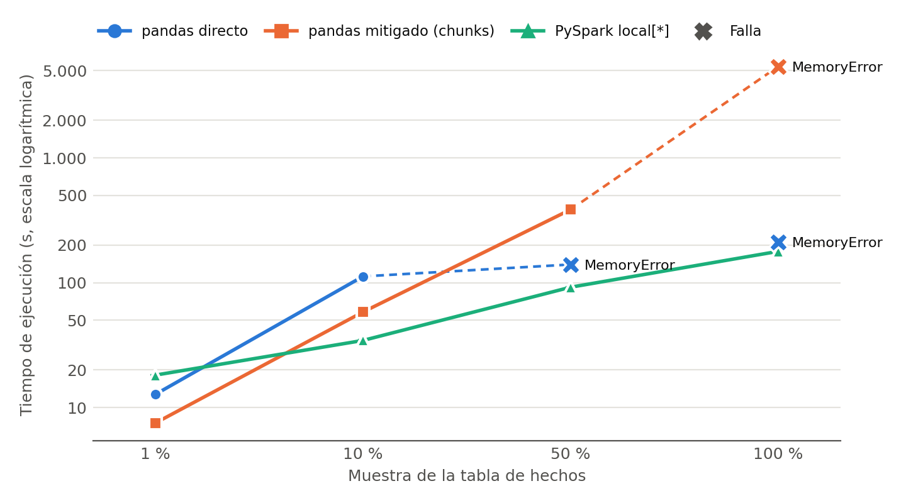
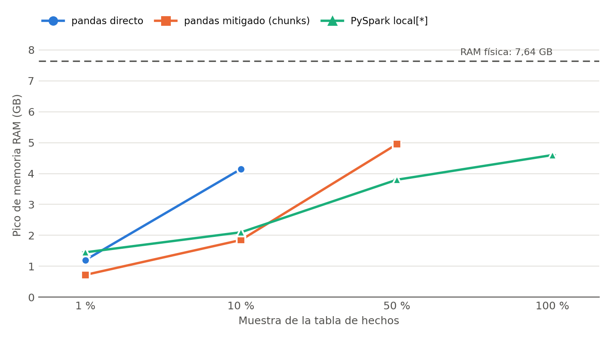

# 6. Análisis comparativo pandas vs. Spark

Esta sección compara las dos versiones con métricas objetivas: tiempo de ejecución, memoria, CPU y escalabilidad (secciones 6.1 a 6.4), y complejidad y legibilidad del código (sección 6.5). La sección 5 documentó las fallas de pandas con capturas del sistema; aquí se cuantifican las tres variantes con mediciones repetidas en el mismo equipo.

## 6.1 Datos y método de comparación

Las cifras de esta sección son las mediciones de la sección 5, tomadas en el equipo de pruebas (13th Gen Intel Core i5-13420H, 8 núcleos y 12 hilos, 7,64 GB de RAM, Windows 11 (build 10.0.26200)) con las mismas cuatro muestras para las tres variantes:

- **pandas directo:** `version_pandas/main.py`, que carga toda la muestra en memoria.
- **pandas mitigado:** la misma versión con `--mitigado`, que aplica las tres mitigaciones del enunciado (lectura por *chunks*, tipos optimizados y selección de columnas).
- **PySpark:** `version_spark/main.py` en modo `local[*]`, con la configuración de la Tabla 8.

En cada ejecución se registró el tiempo total y el pico de memoria física con psutil (Rodola, 2024). Aquí se reorganizan esos datos para compararlos: se calcula cuántas veces más rápido es Spark que cada variante de pandas, se grafica la escalabilidad y se interpreta cada resultado. Las figuras se generaron con matplotlib (Hunter, 2007).

Hay que tener en cuenta un límite: cada combinación se midió **una sola vez**, mientras que el enunciado pide al menos tres repeticiones. Por eso el repositorio incluye `benchmark/medir.py`, que repite cada medición tres veces y lanza cada repetición como un proceso nuevo. El script mide además la memoria y la CPU de todo el árbol de procesos, incluida la JVM de Spark, intercala las versiones para no favorecer a ninguna con la caché de disco y regenera esta sección con `benchmark/graficos.py` e `informe/generar_secciones.py`. Salvo con la muestra del 1 %, las diferencias observadas entre pandas y Spark son de varias veces o directamente entre terminar y fallar, mucho mayores que la variación habitual entre repeticiones de un mismo proceso, así que las conclusiones cualitativas no dependen de ese límite.

## 6.2 Tiempo de ejecución y escalabilidad

La Tabla 11 resume el tiempo de las tres variantes y la Figura 8 lo muestra en escala logarítmica, en la que una recta de pendiente constante indica un crecimiento proporcional al volumen.

**Tabla 11.** *Tiempo de ejecución por variante y muestra (una ejecución por combinación, mediciones de la sección 5) y aceleración de Spark*

| Muestra | Filas | CSV (GB) | pandas directo | pandas mitigado | PySpark | Spark vs. directo | Spark vs. mitigado |
|---|---:|---:|---|---|---|---:|---:|
| 1 % | 1.235.843 | 0,12 | 12,8 s | 7,5 s | 18,2 s | 0,70 × | 0,41 × |
| 10 % | 12.358.430 | 1,15 | 112,4 s | 58,3 s | 34,5 s | 3,26 × | 1,69 × |
| 50 % | 61.792.150 | 5,77 | MemoryError tras 2,3 min | 6,4 min | 92,1 s | solo Spark termina | 4,19 × |
| 100 % | 123.584.300 | 11,53 | MemoryError tras 3,5 min | MemoryError tras más de 1,5 h | 3,0 min | solo Spark termina | solo Spark termina |

La aceleración es el tiempo de pandas dividido entre el de Spark (mayor que 1: Spark es más rápido).



**Figura 8.** *Tiempo de ejecución frente al tamaño de la muestra (escala logarítmica). Cada punto es una ejecución (sección 5); las X marcan el tiempo hasta la falla.*

**Con pocos datos gana pandas.** Con la muestra del 1 % pandas directo terminó en 12,8 s y Spark en 18,2 s, es decir, Spark fue 1,4 veces más lento. La diferencia no se debe al procesamiento sino al costo fijo de Spark: arrancar la JVM, crear la SparkSession, planificar el DAG y coordinar las tareas. Con un volumen tan pequeño ese costo fijo pesa más que el trabajo útil.

**El punto de cruce está en la muestra del 10 %.** A partir de ahí Spark supera a pandas directo (34,5 s frente a 112,4 s, 3,3 veces más rápido), porque el trabajo útil ya es mayor que el costo fijo y Spark lo reparte entre todos los núcleos.

**pandas directo deja de funcionar con el 50 %.** Completó hasta la muestra del 10 % y con el 50 % falló por un error de memoria (MemoryError) después de 2,3 min. Es el comportamiento documentado en la sección 5.

**Las mitigaciones extienden el alcance de pandas, pero no lo vuelven viable.** pandas mitigado completó hasta la muestra del 50 %, en 6,4 min, 4,2 veces lo que tardó Spark con la misma muestra, y con el 100 % falló por un error de memoria (MemoryError) tras más de 1,5 h. Además, aunque termine, su resultado no es exacto: la deduplicación solo ve los duplicados dentro de cada fragmento, y el conteo de clientes únicos exige acumular conjuntos de identificadores que crecen con los datos (sección 5.4). Por eso su tiempo no es comparable en igualdad de condiciones con el de Spark, que sí entrega el resultado exacto.

**Spark completó todas las muestras.** Con el 100 % (123.584.300 filas, 11,53 GB de CSV) tardó 3,0 min. Entre la muestra del 1 % y la del 100 % los datos se multiplicaron por 100 y el tiempo por 9,8: el crecimiento es menor que proporcional porque el costo fijo de arranque se reparte entre más datos y porque, con más archivos, todos los núcleos tienen trabajo.

## 6.3 Consumo de memoria

La Tabla 12 y la Figura 9 muestran el pico de memoria física de cada variante. La línea discontinua de la figura marca la RAM instalada.

**Tabla 12.** *Pico de memoria RAM en GB por variante y muestra (mediciones de la sección 5)*

| Muestra | pandas directo | pandas mitigado | PySpark |
|---|---|---|---|
| 1 % | 1,20 | 0,72 | 1,45 |
| 10 % | 4,15 | 1,85 | 2,10 |
| 50 % | No registrado | 4,95 | 3,80 |
| 100 % | No registrado | No registrado | 4,60 |

RAM física del equipo: 7,64 GB. «No registrado»: la ejecución falló antes de que se registrara el pico de memoria.



**Figura 9.** *Pico de memoria RAM frente al tamaño de la muestra. Cada punto es una ejecución (sección 5); no se grafican las ejecuciones que fallaron sin registrar memoria.*

**En pandas la memoria crece con los datos.** pandas directo necesitó 4,15 GB para la muestra del 10 %, cuyo CSV ocupa 1,15 GB: un factor de 3,6 entre memoria y disco, muy cercano al 3,63 que la Tabla 3 midió para la sola lectura del CSV. Con ese mismo factor, la muestra del 50 % (5,77 GB de CSV) necesitaría unos 20,8 GB, más que los 7,64 GB de RAM del equipo.

La versión mitigada consume menos (4,95 GB con el 50 %), pero su memoria también aumenta con el volumen, porque los conjuntos de clientes únicos y las agregaciones parciales se acumulan durante todo el recorrido.

**En Spark la memoria está acotada.** Su pico estuvo entre 1,45 y 4,60 GB en todas las muestras: mientras los datos crecieron 100 veces, la memoria creció 3,2 veces. El límite lo fija `spark.driver.memory` (4 GB en este equipo, la mitad de la RAM según `sesion.py`), que es el tamaño máximo del *heap* de la JVM; a eso se suman la memoria propia de la JVM y la del proceso de Python. Spark procesa una partición por núcleo, guarda en disco (*spill*) lo que no cabe en el *heap* y libera cada partición al terminarla. Con el 100 %, el pico de 4,60 GB dejó margen para el sistema operativo, a diferencia de pandas directo, que con el 50 % ya había agotado la memoria.

## 6.4 Uso de CPU y paralelismo

Las ejecuciones de la sección 5 no registraron el tiempo de CPU de Spark, de modo que esta parte se basa en lo observado en pandas y en el modelo de ejecución de Spark. La sección 5.4 documenta que pandas ocupó un solo hilo de ejecución, el 8,3 % de la CPU de un procesador de 12 hilos: las operaciones de pandas corren en un único hilo del intérprete de Python y no hay un planificador que reparta el trabajo. Spark, en cambio, divide cada archivo en particiones de hasta 128 MB y en modo `local[*]` ejecuta una tarea por hilo, es decir, hasta 12 tareas a la vez en este equipo.

Los tiempos de la Tabla 11 son coherentes con esa diferencia: con el 10 % de los datos Spark fue 3,3 veces más rápido que pandas directo, una ventaja que no se explica por procesar cada fila más rápido, sino por procesar muchas a la vez. `benchmark/medir.py` registra los núcleos efectivos de cada variante (tiempo de CPU dividido entre tiempo real) para cuantificar este punto.

## 6.5 Complejidad y legibilidad del código

La Tabla 13 compara las dos versiones con métricas objetivas, medidas por etapa con `benchmark/complejidad_codigo.py`. La complejidad ciclomática (McCabe, 1976) cuenta los caminos independientes de una función: cuanto más alta, más difícil es leerla y probarla.

**Tabla 13.** *Complejidad del código por etapa del pipeline: líneas de código efectivas / funciones / complejidad ciclomática máxima de una función*

| Etapa | pandas | PySpark |
|---|---|---|
| Configuración del motor | - | 56 / 4 / 6 |
| Carga | 78 / 3 / 8 | 41 / 3 / 3 |
| Limpieza | 45 / 3 / 8 | 53 / 4 / 2 |
| Joins | 59 / 4 / 4 | 14 / 4 / 1 |
| Agregaciones (4 consultas) | 108 / 6 / 4 | 85 / 7 / 1 |
| Escritura Parquet | 23 / 1 / 2 | 17 / 2 / 1 |
| Mitigación por chunks | 139 / 2 / 18 | - |
| Orquestación (CLI) | 132 / 3 / 9 | 160 / 3 / 9 |
| **Total** | **584 / 22 / 18** | **426 / 27 / 9** |
| Complejidad ciclomática media por función | 4,23 | 1,89 |
| Anidamiento máximo de bloques | 4 | 2 |

Líneas efectivas: sin líneas en blanco, comentarios ni docstrings. Complejidad ciclomática de McCabe: 1 + número de decisiones (if, bucles, except, and/or). Se excluyen los scripts de prueba, validación y benchmark. Medido con `benchmark/complejidad_codigo.py`.

El tamaño total es parecido (584 líneas efectivas en pandas frente a 426 en Spark), pero la complejidad está repartida de forma muy distinta. En Spark la complejidad media por función es 1,89 y ninguna función supera 9; en pandas la media es 4,23 y el máximo llega a 18, en `ejecutar_pipeline_mitigado_por_chunks` (139 líneas). Esa función concentra el costo de las mitigaciones: tiene que repetir a mano lo que Spark hace solo (recorrer fragmentos, acumular resultados parciales de cada consulta, combinarlos al final y guardar conjuntos de identificadores para el conteo distinto).

Tres diferencias explican el resultado:

- **Spark es declarativo.** El código describe *qué* se quiere (filtros, joins, agrupaciones) y Catalyst decide *cómo* ejecutarlo: el orden de las operaciones, qué columnas leer, el tipo de join y el número de particiones. En pandas cada una de esas decisiones está escrita en el código o simplemente no se toma.
- **El particionamiento es transparente.** En pandas, pasar de procesar todo en memoria a procesar por fragmentos obligó a escribir un segundo pipeline (`mitigaciones.py`) con lógica distinta para cada consulta. En Spark el mismo código sirve para 1 GB o para 100 GB, en un portátil o en un clúster; solo cambia la configuración de la sesión.
- **Las operaciones globales son una sola llamada.** La deduplicación global es `dropDuplicates`, el conteo exacto de clientes únicos es `countDistinct` y el top 10 por departamento es una función de ventana con `rank()`. Los joins ocupan 14 líneas en Spark frente a 59 en pandas.

El fragmento siguiente muestra el contraste en la consulta 4. En pandas mitigado los clientes únicos se acumulan en conjuntos de Python que crecen con los datos:

```python
# pandas mitigado (mitigaciones.py): estado que hay que mantener a mano entre fragmentos
for (seg, mes), grupo in df_validos.groupby(["segmento", "anio_mes"])["cliente_id"]:
    sets_clientes_unicos.setdefault((str(seg), str(mes)), set()).update(grupo.values)
...
conteos = [{"segmento": s, "anio_mes": m, "clientes_unicos": len(st)}
           for (s, m), st in sets_clientes_unicos.items()]
```

En Spark es una agregación más, y el motor se encarga del reparto por clave y del *spill* a disco:

```python
# PySpark (agregaciones.py)
.groupBy("segmento", "anio_mes")
.agg(F.round(F.avg("venta_neta"), 2).alias("ticket_promedio"),
     F.countDistinct("cliente_id").alias("clientes_unicos"), ...)
```

Spark también tiene costos de legibilidad. Exige una etapa que pandas no necesita, la configuración de la sesión (`sesion.py`, 56 líneas), y un orquestador más largo, porque por la evaluación perezosa hay que provocar acciones explícitas (`count`, `write`) para medir cada etapa. Depurar también es más difícil: un error en una transformación aparece en la acción que la ejecuta, a veces varias líneas después, y la traza mezcla Python y Java. Para un analista que ya conoce pandas, la sintaxis de Spark es familiar (DataFrames, `groupBy`, `join`) y además admite SQL, como en la consulta 2, que resuelve en una sola pasada lo que en pandas requiere tres agrupaciones y dos `merge`.

## 6.6 Interpretación crítica y límites del análisis

Los resultados confirman lo que anticipaba el marco teórico, pero conviene precisar su alcance:

- **La ventaja de Spark en un solo equipo viene del paralelismo y del uso del disco, no de la distribución.** En modo `local[*]` no hay red ni varios nodos: Spark gana porque usa todos los núcleos y porque puede trabajar con más datos que su memoria. En un clúster el mismo código escalaría además horizontalmente, pero este trabajo no lo midió.
- **pandas sigue siendo la mejor opción con datos pequeños.** Con la muestra del 1 % fue más rápido (12,8 s frente a 18,2 s) y más simple. La conclusión no es que Spark sea mejor siempre, sino que hay un volumen a partir del cual pandas deja de ser viable en un equipo dado. Ese umbral depende de la RAM del equipo.
- **La comparación con pandas mitigado no es entre iguales.** Esa variante sacrifica exactitud (deduplicación local) para ahorrar memoria, así que un tiempo menor no significa un resultado equivalente. La equivalencia exacta entre pandas directo y Spark se verificó con `version_spark/validar_equivalencia.py` (sección 4.2.7).
- **Hay factores que la medición no controla del todo.** Cada combinación se midió una vez, así que no se puede estimar la variabilidad; la caché de disco del sistema operativo pudo favorecer a la variante que leyó los archivos en segundo lugar. El RSS de Windows no incluye la memoria enviada al archivo de paginación, de modo que el pico de pandas antes de fallar subestima lo que intentó reservar. Además, los datos son sintéticos: aunque se generaron con distribuciones realistas, un conjunto real podría tener otras proporciones de errores o de claves repetidas.
- **Spark también tiene límites en este equipo.** Con 4 GB asignados a la JVM, operaciones como el join con los 5 millones de clientes y la deduplicación global escriben datos intermedios en disco. Con un disco lento o sin espacio en `SPARK_LOCAL_DIRS`, el tiempo aumentaría o el proceso fallaría.

# 7. Conclusiones

1. **Importancia.** El proyecto mostró de forma experimental que existe un límite práctico para las herramientas de un solo proceso en memoria, y que ese límite lo fija el equipo, no el tamaño absoluto de los datos. Con el conjunto completo (123,58 millones de filas, 11,53 GB), Spark terminó en 3,0 min con un pico de 4,60 GB, mientras que pandas directo falló desde la muestra del 50 % por un error de memoria (MemoryError). Para este problema, Spark no es una alternativa más rápida, sino la única forma viable de obtener el resultado completo en el mismo equipo.

2. **Eficiencia.** Spark fue más eficiente por tres mecanismos, y no por procesar cada fila más rápido:
   - **paralelismo:** aprovechó todos los hilos del procesador con una tarea por partición, mientras que pandas usó uno solo;
   - **memoria acotada:** su consumo quedó limitado por `spark.driver.memory` y creció mucho menos que los datos, gracias al *spill* a disco;
   - **optimización del plan:** la evaluación perezosa permitió a Catalyst leer solo las columnas necesarias, aplicar los filtros temprano y elegir *broadcast join* para las dimensiones pequeñas.

   La eficiencia tiene un costo fijo: arrancar la JVM y planificar el DAG. Por eso pandas fue más rápido con datos pequeños (con el 1 %, 12,8 s en pandas frente a 18,2 s en Spark) y a partir de la muestra del 10 % la relación se invierte.

3. **Aplicabilidad.** Spark conviene cuando los datos superan o se acercan a la memoria disponible, cuando el análisis requiere operaciones globales exactas (deduplicación, conteos distintos, rankings, joins entre tablas grandes) y cuando el volumen va a crecer. pandas sigue siendo preferible para exploración, prototipos y conjuntos que caben con holgura en memoria. Su API es más directa, no requiere Java ni configurar variables de entorno, y su sobrecarga es mínima. Una práctica razonable es combinar ambos: reducir los datos con Spark y continuar el análisis del resultado agregado, que es pequeño, en pandas.

4. **Utilidad y relación con casos reales.** El caso estudiado, consolidar años de transacciones de puntos de venta con los maestros de clientes, productos y tiendas, es representativo de lo que hacen a diario el comercio minorista, la banca o las telecomunicaciones. Zaharia et al. (2016) reportan miles de despliegues de Spark en aplicaciones que van de las finanzas al procesamiento de datos científicos, con clústeres públicos de más de 8.000 nodos. El código de este proyecto se ejecutaría sin cambios en un clúster de ese tipo, porque solo cambiaría el parámetro `master` de la sesión. Esa portabilidad es una ventaja práctica: el mismo programa sirve para desarrollar en un portátil y para producción.

5. **Complejidad del código.** Implementar las mitigaciones en pandas obligó a escribir un segundo pipeline más complejo y menos exacto, mientras que en Spark las operaciones globales son llamadas declarativas. La complejidad ciclomática media por función fue 1,89 en Spark frente a 4,23 en pandas. El costo de Spark es otro: configurar el entorno, en especial en Windows (sección 3.7), y depurar planes que se ejecutan de forma perezosa.

6. **Limitaciones de Spark.** Tiene sobrecarga con datos pequeños, depende de la JVM y de una configuración delicada en Windows (versión de Java, `winutils.exe`, `hadoop.dll`, rutas sin espacios), consume memoria fija aunque los datos sean pocos y su rendimiento depende del disco cuando hay *spill*. Además, este trabajo evaluó solo el modo local en un equipo, con datos sintéticos. Queda como trabajo futuro medir el mismo código en un clúster de varios nodos y con datos reales.

# 8. Referencias

::: {.referencias}
Apache Software Foundation. (2026). *Apache Spark 3.5.9* [Software]. https://spark.apache.org

Armbrust, M., Xin, R. S., Lian, C., Huai, Y., Liu, D., Bradley, J. K., Meng, X., Kaftan, T., Franklin, M. J., Ghodsi, A., & Zaharia, M. (2015). Spark SQL: Relational data processing in Spark. En *Proceedings of the 2015 ACM SIGMOD International Conference on Management of Data* (pp. 1383–1394). Association for Computing Machinery. https://doi.org/10.1145/2723372.2742797

cdarlint. (s. f.). *winutils: Binarios de Hadoop para Windows* [Repositorio de GitHub]. https://github.com/cdarlint/winutils

Chambers, B., & Zaharia, M. (2018). *Spark: The definitive guide. Big data processing made simple*. O'Reilly Media.

Eclipse Adoptium. (s. f.). *Eclipse Temurin JDK 17* [Software]. https://adoptium.net

endoflife.date. (2026). *Apache Spark*. https://endoflife.date/apache-spark

Hunter, J. D. (2007). Matplotlib: A 2D graphics environment. *Computing in Science & Engineering, 9*(3), 90–95. https://doi.org/10.1109/MCSE.2007.55

Laney, D. (2001). *3D data management: Controlling data volume, velocity and variety*. META Group.

McCabe, T. J. (1976). A complexity measure. *IEEE Transactions on Software Engineering, SE-2*(4), 308–320. https://doi.org/10.1109/TSE.1976.233837

McKinney, W. (2017, 21 de septiembre). *Apache Arrow and the "10 things I hate about pandas"*. https://wesmckinney.com/blog/apache-arrow-pandas-internals/

McKinney, W. (2022). *Python for data analysis: Data wrangling with pandas, NumPy, and Jupyter* (3.ª ed.). O'Reilly Media.

Rodola, G. (2024). *psutil 6.1.1: Cross-platform lib for process and system monitoring in Python* [Software]. https://github.com/giampaolo/psutil

The pandas development team. (2024). *pandas 2.2.3* [Software]. Zenodo. https://doi.org/10.5281/zenodo.3509134

Western Digital. (2024). *PC SN5000S NVMe SSD specifications*. Western Digital Technologies.

Zaharia, M., Chowdhury, M., Das, T., Dave, A., Ma, J., McCauley, M., Franklin, M. J., Shenker, S., & Stoica, I. (2012). Resilient distributed datasets: A fault-tolerant abstraction for in-memory cluster computing. En *9th USENIX Symposium on Networked Systems Design and Implementation (NSDI 12)* (pp. 15–28). USENIX Association.

Zaharia, M., Xin, R. S., Wendell, P., Das, T., Armbrust, M., Dave, A., Meng, X., Rosen, J., Venkataraman, S., Franklin, M. J., Ghodsi, A., Gonzalez, J., Shenker, S., & Stoica, I. (2016). Apache Spark: A unified engine for big data processing. *Communications of the ACM, 59*(11), 56–65. https://doi.org/10.1145/2934664
:::
